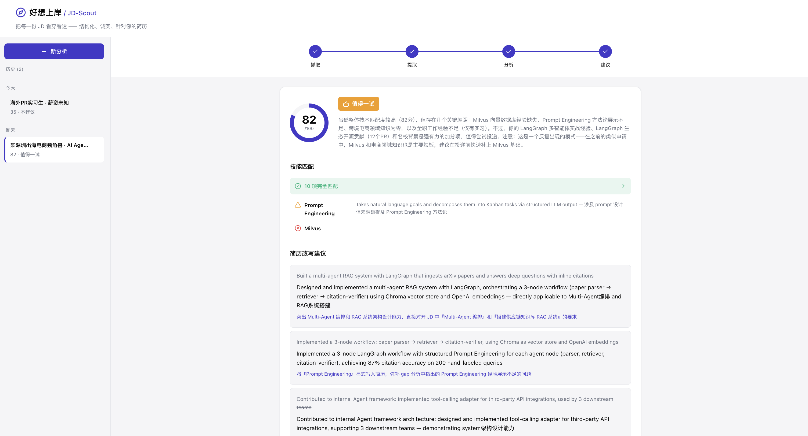
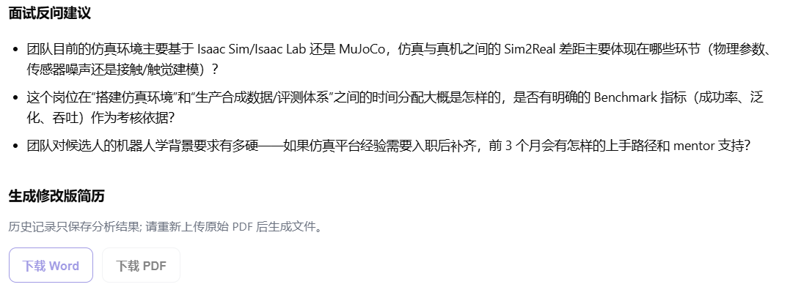
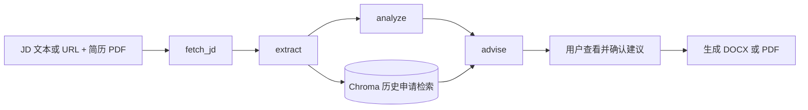

# JobFit Studio

> AI 求职匹配与简历定制系统

[](LICENSE)
[](https://www.python.org/downloads/)
[](https://github.com/langchain-ai/langgraph)
[](https://www.docker.com/)

English version: [README.md](README.md)

JobFit Studio 是一个面向求职者的本地优先工具。它结合职位描述（JD）与用户上传的 PDF 简历，分析岗位要求和简历证据，给出匹配情况、能力差距、针对性改写建议与面试准备重点。用户可以逐条确认或编辑建议，并生成新版 DOCX 或 PDF 简历。

JobFit Studio 是由 GitHub 用户 **BigGooseDun** 在开源项目 [JD-Scout](https://github.com/AlanYy-42/JD-Scout) 基础上继续开发的衍生项目。原项目及其作者保留原有版权；本项目在保留上游 MIT 许可证声明的基础上，新增并维护了用户确认式简历改写、DOCX/PDF 生成、简历照片提取与模板优化等功能。新增与修改内容的贡献归属见项目 [LICENSE](LICENSE)。

## 功能

- **岗位分析工作流**：使用 LangGraph 将抓取、岗位要求提取、简历匹配分析和建议生成组织为四个节点。
- **证据化匹配报告**：展示整体匹配度、逐项技能匹配情况、简历证据和关键差距。
- **简历与面试建议**：生成与目标岗位相关的简历改写建议、面试准备重点及面试反问建议。
- **历史申请参考**：保存分析历史，并通过本地向量检索提供相似岗位申请作为建议上下文。
- **实时进度**：网页通过 SSE 展示分析节点的执行进度。
- **职位描述获取**：支持粘贴 JD 文本或提供 URL；URL 抓取先使用 HTTPX，必要时使用 Playwright 渲染 JavaScript 页面。
- **确认后生成新简历**：用户可以确认并编辑改写内容，再下载新版 DOCX 或 PDF；原始 PDF 不会被覆盖。
- **保守改写应用**：按精确、文本归一化和高置信度模糊匹配尝试定位原文。无法安全定位的建议仍会写入待确认区域；低匹配度且自动改写较少时，会提供润色备选。
- **模板与照片保留**：重新排版生成简历，尽可能提取并保留原 PDF 中的照片；DOCX 可继续编辑，PDF 使用嵌入式中文字体。
- **中英文界面**：支持中英文界面和系统浅色/深色主题。
- **CLI 与 Docker**：可从命令行运行岗位分析，也可使用 Docker Compose 启动 Web 服务。

### 继承自 JD-Scout 的能力

- **四节点 LangGraph 智能体工作流**：抓取职位描述、提取岗位要求、分析简历差距、生成建议，并以 Pydantic 约束结构化结果。
- **历史申请 RAG**：通过 Chroma 检索相似的历史岗位，为当前建议补充上下文。
- **简历证据约束**：提示词要求以简历内容为依据，并使用结构校验、空结果检查和重试处理部分模型输出异常；生成内容仍需人工核对。
- **SSE 节点进度**：网页可实时显示 `fetch → extract → analyze → advise` 工作流进展。
- **混合网页抓取**：HTTPX 优先，JavaScript 页面可回退至 Playwright；不绕过登录或反爬限制。
- **中英双语与主题适配**：保留原有双语界面和浅色/深色主题支持。

## 功能示例

### 原项目功能演示

以下截图来自上游 JD-Scout 项目的演示案例，用于展示本项目继承的岗位匹配分析界面；截图及其中原有功能属于上游项目展示内容。



### JobFit Studio 新增功能演示

以下截图展示本项目新增的面试反问建议和修改版简历下载入口。



## 工作流



四个节点通过共享的 `AgentState` 传递数据。岗位要求、匹配分析和建议由 DeepSeek 生成，并通过 Pydantic 结构约束结果。建议阶段会检索相似历史申请；检索失败时按无历史上下文继续。网页以 SSE 接收工作流进度，历史分析写入 SQLite，向量索引由 Chroma 管理。

简历导出只应用用户确认的改写。程序不能可靠定位某条原文时，不会强行替换，而是把建议放入新文件的待确认区域，供用户在 Word 中检查和调整。

## 快速开始

### 本地运行

#### 运行前提

- Windows、macOS 或 Linux；Python 3.11 或更高版本。
- [uv](https://docs.astral.sh/uv/) 用于按 `pyproject.toml` 和 `uv.lock` 创建虚拟环境并安装锁定依赖，不需要手动逐个安装 Python 包。
- DeepSeek API Key：分析请求需要调用 DeepSeek。没有 Key 时可以安装项目，但不能完成 AI 分析。
- 网络连接：首次安装需要下载 Python 依赖；首次 RAG 检索需要下载多语言 embedding 模型。使用职位 URL 时还需要访问目标站点。
- Playwright Chromium：仅当需要抓取 JavaScript 渲染的职位网页时需要；如果始终粘贴 JD 文本，可跳过浏览器安装。
- PDF 中文字体：PDF 导出需要本机可用的中文 TrueType 字体。Windows 默认尝试系统中文字体；Docker 镜像包含 Noto CJK。其他 Linux 环境请安装 Noto CJK 等中文字体，或设置 `JDSCOUT_CJK_FONT`。

#### 安装步骤

Windows PowerShell：安装 Python 后，可通过 `winget install astral-sh.uv` 安装 uv。macOS/Linux 用户请按 [uv 官方安装说明](https://docs.astral.sh/uv/getting-started/installation/) 安装。

```bash
git clone https://github.com/BigGooseDun/JobFit-Studio.git
cd JobFit-Studio
uv sync
```

`uv sync` 会根据 `pyproject.toml` 和 `uv.lock` 创建项目虚拟环境 `.venv` 并安装运行依赖。复制 `.env.example` 为 `.env`，填入 `DEEPSEEK_API_KEY`。PowerShell 可运行：

```powershell
Copy-Item .env.example .env
```

需要 URL 动态抓取时安装 Playwright Chromium：

```bash
uv run playwright install chromium
```

启动 Web 服务：

```bash
uv run uvicorn jdscout.api.server:app --host 127.0.0.1 --port 8000
```

打开 <http://127.0.0.1:8000>。`uv run` 会在项目虚拟环境中运行命令。首次使用历史相似岗位检索时，Sentence-Transformers 会下载 `paraphrase-multilingual-MiniLM-L12-v2` 模型；下载完成后从本地缓存加载。

### Docker Compose

```bash
cp .env.example .env
# 在 .env 中填写 DEEPSEEK_API_KEY
docker compose up --build
```

打开 <http://localhost:8000>。Compose 配置将 `~/.jdscout` 挂载为持久化目录，用于保存历史记录和向量数据。

### 命令行分析

```bash
uv run python -m jdscout.cli \
  --jd "粘贴完整 JD 文本或提供职位页面 URL" \
  --resume examples/sample_resume.pdf \
  --output result.json
```

简历 DOCX/PDF 导出目前通过 Web 分析页面提供。完成分析后，检查并确认改写建议，再选择下载 Word 或 PDF。

## 配置

配置写入项目根目录 `.env`：

| 变量 | 必填 | 说明 |
| --- | --- | --- |
| `DEEPSEEK_API_KEY` | 是 | DeepSeek 模型调用凭证，可从 [DeepSeek Platform](https://platform.deepseek.com/) 获取。 |
| `CHROMA_DIR` | 否 | Chroma 向量库目录，默认 `~/.jdscout/chroma`。 |
| `SQLITE_PATH` | 否 | SQLite 历史库文件，默认 `~/.jdscout/history.db`。 |
| `JDSCOUT_CJK_FONT` | 否 | PDF 导出使用的中文字体路径；未设置时尝试查找系统字体。Docker 镜像提供 Noto CJK。 |

不要把真实 API Key 提交到 GitHub。`.env` 已由 `.gitignore` 排除；发布前仍应检查提交内容。

## 技术栈

- **Python**：3.11+
- **工作流与模型调用**：LangGraph、LangChain、DeepSeek OpenAI 兼容 API
- **结构化数据**：Pydantic
- **服务端**：FastAPI、Uvicorn、SSE
- **前端**：原生 HTML、CSS、JavaScript
- **PDF 处理**：pdfplumber、pypdfium2、Pillow
- **简历生成**：python-docx、ReportLab
- **历史存储与检索**：SQLite、Chroma、Sentence-Transformers（`paraphrase-multilingual-MiniLM-L12-v2`）
- **网页抓取**：HTTPX、BeautifulSoup、Playwright
- **依赖与部署**：uv、Docker、Docker Compose

## 致谢

本项目基于 [JD-Scout](https://github.com/AlanYy-42/JD-Scout) 继续开发。感谢原作者及 LangGraph、LangChain、DeepSeek、Chroma、Sentence-Transformers 和 Lucide 项目的维护者与贡献者。

## 限制与注意事项

- 项目面向个人本地使用，目前没有登录认证、多用户隔离或 SaaS 级别的安全设计；不要将服务直接暴露到公网。
- 模型输出可能不完整或不准确。结构化校验和简历证据约束可以降低错误，但不能代替用户审核。
- 职位网站可能有登录墙、反爬或动态加载限制；抓取失败时可直接粘贴 JD 文本。Playwright 不用于绕过访问控制。
- PDF 文本抽取对扫描件、复杂多栏布局和特殊编码字体可能不完整；照片提取也属于尽力而为。
- PDF/DOCX 是根据提取文本重新排版生成，不保证与源简历逐像素一致。请检查内容、分页和版式后再投递。
- RAG 仅使用本地历史申请作为参考，检索相似度不代表建议正确，也不会消除模型错误。
- Sentence-Transformers 模型首次使用时可能需要联网下载；离线使用前请确认模型已缓存。

## 开发与测试

```bash
uv sync --extra dev
uv run pytest
```

项目使用 `pyproject.toml` 声明依赖，并使用 `uv.lock` 锁定完整解析版本；`requirements.txt` 不是本项目的依赖管理入口。修改依赖后应运行 `uv lock` 更新锁文件，再运行 `uv sync` 验证环境可复现。

## 许可

本项目采用 [MIT License](LICENSE)。
