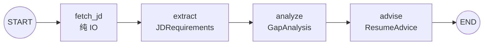

# 好想上岸 · JD-Scout

> 把每一份 JD 都看穿看透 —— 结构化、诚实、针对*你自己*的简历。

[](https://www.python.org/downloads/)
[](LICENSE)
[](https://github.com/langchain-ai/langgraph)

**好想上岸（JD-Scout）** 是一个用 LangGraph 做的 AI Agent：抓取 JD → 结构化提取需求 → 与你的简历做 gap 分析 → 生成简历改写建议和面试重点。

写给秋招/春招要投几十家、每份 JD 三分钟读不完的求职者 —— 第一个用户就是作者自己。English version: [README.md](README.md).

## 特性

- **结构化、反幻觉的提取** —— 每个 LLM 输出都用 Pydantic schema 强约束；prompt 明确禁止编造技能或成果；技能匹配必须引用简历原句作为证据。
- **诚实打分** —— prompt 明确要求*不许*为了鼓励而拔高匹配度；不合适就直说。
- **稳健的 LLM 调用** —— 结构化输出外包了一层有限次退避重试（源于真实观测：DeepSeek 的 function-calling 偶发返回空）。
- **多格式输出** —— 机器可读的 JSON + 人类可读的 Markdown 报告。
- **稳健的 PDF 解析** —— pdfplumber 为主（擅长多列），检测到粗体字形双写时自动 fallback 到 pypdfium2。

## 快速开始

### 方式 A —— 本地（uv）

```bash
uv sync --extra dev              # 安装依赖
cp .env.example .env             # 然后填入你的 DEEPSEEK_API_KEY
uv run python -m jdscout.cli \
    --jd "把 JD 全文粘贴到这里，或给一个 URL" \
    --resume examples/sample_resume.pdf \
    --output report.json --output-md report.md
```

### 方式 B —— Docker

```bash
docker build -t jdscout .
# 挂载一个目录放简历和输出；API key 运行时注入，不进镜像
docker run --rm --env-file .env -v "$(pwd)/examples:/data" jdscout \
    --jd "把 JD 全文粘贴到这里，或给一个 URL" \
    --resume /data/sample_resume.pdf \
    --output /data/report.json
```

或用 Compose：`docker compose run --rm jdscout --jd "..." --resume /data/sample_resume.pdf --output /data/report.json`

不加 `--output` 时报告直接打印到终端。查看全部参数：`uv run python -m jdscout.cli --help`。

## 架构



一条线性的四节点 LangGraph。数据在共享的 `AgentState` 上流转：每个节点消费上游字段、写出自己的产出（`errors` 用加法 reducer，让多个节点的错误累加而非互相覆盖）。

| 节点 | 作用 | 产出 |
| --- | --- | --- |
| `fetch_jd` | 抓取/接收 JD 文本（启发式，无 LLM） | `jd_raw_text` |
| `extract` | 结构化提取岗位需求 | `JDRequirements` |
| `analyze` | 简历 vs JD 差距分析 | `GapAnalysis` |
| `advise` | 简历改写建议 + 面试重点 | `ResumeAdvice` |

## 输出示例

一份完整的端到端跑通结果（FinTech AI-Agent JD × 示例简历）：
- JSON：[`examples/sample_output.json`](examples/sample_output.json)
- Markdown：[`examples/sample_output.md`](examples/sample_output.md)

## 已知限制（MVP）

- 动态渲染的招聘网站（BOSS 直聘、LinkedIn 等）抓不到 —— 请手动粘贴 JD 文本。
- 只支持文字版 PDF 简历，扫描版需要 OCR（Phase 2）。
- DeepSeek 的 function-calling 偶发即使重试后仍返回不了结构化输出 —— 多见于输出最大的 `advise` 节点；遇到时重跑一次即可。

## 路线图（Phase 2+）

- Web UI（FastAPI + 轻量前端）
- Chroma 向量库存历史投递 + “你之前投过 N 个类似岗位”
- Playwright fallback，处理动态渲染网站
- 简单 memory：记住简历版本
- 中英双语 demo GIF + 文档精修

## 致谢

- [LangGraph](https://github.com/langchain-ai/langgraph) —— 核心的多节点 Agent 框架。
- [DeepSeek](https://platform.deepseek.com) —— 驱动提取与分析的 LLM。

## 许可

[MIT](LICENSE)
