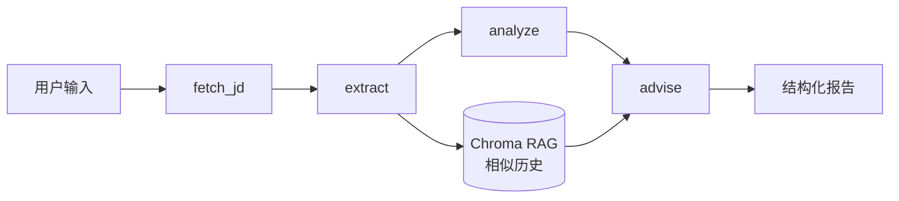

# 好想上岸（JD-Scout）

> **AI 帮你把每一份 JD 看穿看透**

[](LICENSE)
[](https://www.python.org/downloads/)
[](https://github.com/langchain-ai/langgraph)
[](https://www.docker.com/)

English version: [README.md](README.md)

## 项目简介

JD-Scout 吃进一份岗位 JD 和你的简历，输出一份结构化的匹配报告：命中了哪些要求的技能（并从简历里引用证据）、关键缺口在哪、针对性的简历 bullet 改写、以及面试重点。它还会记住你过往的投递，检索出相似岗位，让建议参考你的历史模式而不只看当前这份 JD。写给要投几十家、每份 JD 三分钟读不完的求职者——第一个用户就是作者本人，正在秋招 AI Agent 岗位。

## Demo


30 秒看 JD-Scout 分析一份真实 JD。

## 特性

- **4 节点 LangGraph 智能体工作流**，每一步都用 Pydantic 强约束结构化输出
- **Agentic RAG**：用 Chroma 向量库做历史投递匹配
- **反幻觉防御**：schema 校验 + prompt 级 "Do NOT invent" + 从简历引用证据
- **静默 None 失败兜底**：显式 None 检查 + 结构化输出的指数退避重试
- **SSE 实时进度**——节点级流式（fetch → extract → analyze → advise）
- **混合网页抓取**：HTTPX 优先 + Playwright fallback 处理 JS 渲染网站
- **中英双语 UI**，跟随系统的浅色/深色主题
- **Docker Compose 一条命令部署**

## 架构



数据在共享的 `AgentState` 上流转：每个节点消费上游字段、写出自己的产出。`fetch_jd` 纯 IO（无 LLM）；`extract`/`analyze`/`advise` 用 DeepSeek + Pydantic 强约束结构化输出。`advise` 节点从 Chroma 检索相似历史投递，注入自己的 prompt。

## 快速开始

### 方式 A —— 本地（uv，推荐开发用）

```bash
git clone https://github.com/AlanYy-42/JD-Scout.git && cd JD-Scout
uv sync
uv run playwright install chromium        # JS 渲染网站的 fallback 需要
cp .env.example .env                       # 然后填入 DEEPSEEK_API_KEY
uv run uvicorn jdscout.api.server:app --port 8000
# 打开 http://localhost:8000
```

### 方式 B —— Docker（推荐类生产环境）

```bash
cp .env.example .env                       # 填入 DEEPSEEK_API_KEY
docker compose up
# 打开 http://localhost:8000
```

### 方式 C —— CLI（无界面）

```bash
uv run python -m jdscout.cli \
    --jd "粘贴 JD 原文或一个 URL" \
    --resume examples/sample_resume.pdf \
    --output result.json
```

## 配置

环境变量（写在 `.env`）：

| 变量 | 必填 | 说明 |
| --- | --- | --- |
| `DEEPSEEK_API_KEY` | ✅ | 从 https://platform.deepseek.com 获取 |
| `CHROMA_DIR` | 可选 | 向量库位置（默认 `~/.jdscout/chroma`） |
| `SQLITE_PATH` | 可选 | 历史库位置（默认 `~/.jdscout/history.db`） |

## 已知限制

诚实标注，不掩盖：

- **DeepSeek function-calling 不稳定**：长结构化输出偶发失败（`advise` 节点最受影响）。用 3 次指数退避重试缓解；残留失败率约 5–10%。理由：根因是上游 API 的抖动——把重试次数调更高只会*掩盖*现实，而非修复它。遇到失败重跑即可。
- **max_tokens 截断**：把 DeepSeek 上限提到 8192，并给每个节点加 None 兜底，把静默截断变成显式错误。
- **Playwright 抓取边界**：不绕过反爬。BOSS 直聘 / LinkedIn / 脉脉（登录墙 + 强反爬）**不支持**。建议直接粘贴 JD 文本——效果完全一样。
- **Embedding 只到表层语义**：区分不了"FinTech 的 AI Agent"和"电商的 AI Agent"这种业务领域差异。未来：加 rerank 层。
- **单用户部署**：无鉴权、无多租户。面向个人使用，不是 SaaS。

## 路线图

- `advise` 节点自然语言字段的 token 级流式
- rerank 层，把 RAG 精度提升到表层语义之上
- 多模型 failover（反复失败时 DeepSeek → GPT-4）
- 通过 Cloudflare Tunnel 公网部署（暂不提供——成本/合规考量）

## 技术栈

- **语言**：Python 3.11+
- **Agent 框架**：LangGraph 1.2.x, LangChain 1.3.x
- **LLM**：DeepSeek-V3（OpenAI-compatible 接口）
- **结构化输出**：Pydantic 2.x
- **向量库**：Chroma 0.5.x
- **Embedding**：sentence-transformers（`paraphrase-multilingual-MiniLM-L12-v2`）
- **后端**：FastAPI + uvicorn（SSE 用 `StreamingResponse`）
- **前端**：原生 HTML/JS/CSS（无构建步骤）
- **PDF 解析**：pdfplumber + pypdfium2 fallback
- **网页抓取**：httpx + Playwright fallback
- **持久化**：SQLite（历史）+ Chroma（向量）
- **部署**：Docker + Docker Compose

## 致谢

- LangGraph & LangChain 团队
- DeepSeek 提供实惠的 LLM 推理
- Chroma 的嵌入式向量库
- UKPLab 的 sentence-transformers
- Lucide icons

## 许可

[MIT](LICENSE)
