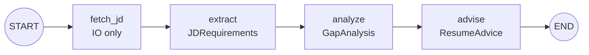

# JD-Scout

> Read every job description like a scout — structured, honest, tailored to *your* resume.

[](https://www.python.org/downloads/)
[](LICENSE)
[](https://github.com/langchain-ai/langgraph)

**JD-Scout** is a LangGraph AI agent that dissects any job description against your resume: it fetches the JD, extracts structured requirements, runs a gap analysis against your resume, and produces tailored rewrite suggestions and interview-prep focus points.

Built for job seekers who face dozens of postings and can't read each one — starting with its own author. 中文版见 [README-CN.md](README-CN.md)（“好想上岸”）。

## Features

- **Structured, hallucination-resistant extraction** — every LLM output is constrained by a Pydantic schema; prompts explicitly forbid inventing skills or achievements, and skill matches must cite evidence from the resume.
- **Honest scoring** — the agent is prompted *not* to inflate the match score; it will tell you when a role is a stretch.
- **Resilient LLM calls** — bounded retry with backoff around structured output, after real-world observation that DeepSeek's function-calling occasionally returns nothing.
- **Multi-format output** — machine-readable JSON *and* a human-readable Markdown report.
- **Robust PDF parsing** — pdfplumber primary (handles multi-column) with automatic pypdfium2 fallback when faux-bold glyph doubling is detected.

## Quick Start

### Option A — Local (uv)

```bash
uv sync --extra dev              # install deps
cp .env.example .env             # then fill in DEEPSEEK_API_KEY
uv run python -m jdscout.cli \
    --jd "paste the full JD here, or give a URL" \
    --resume examples/sample_resume.pdf \
    --output report.json --output-md report.md
```

### Option B — Docker

```bash
docker build -t jdscout .
# mount a folder for your resume + output; inject the API key at runtime
docker run --rm --env-file .env -v "$(pwd)/examples:/data" jdscout \
    --jd "paste the full JD here, or give a URL" \
    --resume /data/sample_resume.pdf \
    --output /data/report.json
```

Or with Compose: `docker compose run --rm jdscout --jd "..." --resume /data/sample_resume.pdf --output /data/report.json`

Without `--output`, the report prints to stdout. See all flags: `uv run python -m jdscout.cli --help`.

## Architecture



A linear four-node LangGraph. State flows on a shared `AgentState`: each node consumes upstream fields and writes its own (`errors` uses an additive reducer so failures accumulate rather than overwrite).

| Node | Role | Produces |
| --- | --- | --- |
| `fetch_jd` | Fetch/accept JD text (heuristics, no LLM) | `jd_raw_text` |
| `extract` | Structured requirement extraction | `JDRequirements` |
| `analyze` | Resume-vs-JD gap analysis | `GapAnalysis` |
| `advise` | Rewrite suggestions + interview prep | `ResumeAdvice` |

## Sample Output

A full end-to-end run (FinTech AI-Agent JD × sample resume):
- JSON: [`examples/sample_output.json`](examples/sample_output.json)
- Markdown: [`examples/sample_output.md`](examples/sample_output.md)

## Known Limitations (MVP)

- JS-rendered job boards (BOSS 直聘, LinkedIn, etc.) can't be scraped — paste the JD text directly.
- Text-based PDF resumes only; scanned resumes need OCR (Phase 2).
- DeepSeek's function-calling occasionally fails to return structured output even after retries — most common on the largest node (`advise`); re-run when it happens.

## Roadmap (Phase 2+)

- Web UI (FastAPI + lightweight frontend)
- Chroma vector store for application history + "similar roles you've applied to"
- Playwright fallback for JS-rendered job boards
- Lightweight memory: remember resume versions
- Bilingual demo GIF + polished docs

## Acknowledgments

- [LangGraph](https://github.com/langchain-ai/langgraph) — the multi-node agent framework at the core.
- [DeepSeek](https://platform.deepseek.com) — the LLM behind extraction and analysis.

## License

[MIT](LICENSE)
