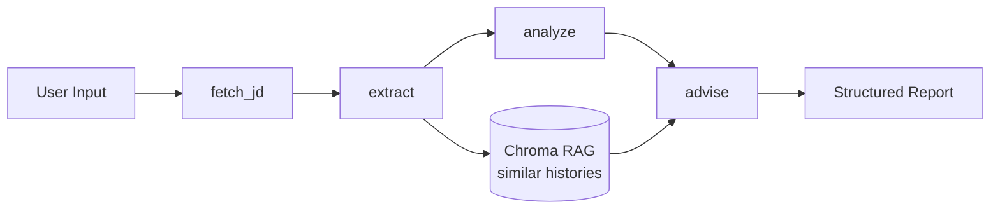

# JD-Scout（好想上岸）

> **AI-powered JD analysis agent for job seekers**

[](LICENSE)
[](https://www.python.org/downloads/)
[](https://github.com/langchain-ai/langgraph)
[](https://www.docker.com/)

中文版：[README-CN.md](README-CN.md)

## Overview

JD-Scout ingests a job description and your resume, then outputs a structured match report: which required skills you match (with evidence cited from your resume), where the critical gaps are, tailored resume-bullet rewrites, and interview-prep focus points. It also remembers your past applications and surfaces similar ones so its advice reflects your history, not just the current JD. Built for job seekers facing dozens of postings — starting with its own author, who is job-hunting for AI Agent roles.

## Demo


See a live demo of JD-Scout analyzing a real JD in 30 seconds.

## Features

- **4-node LangGraph agentic workflow** with Pydantic structured output at every step
- **Agentic RAG** with a Chroma vector store for historical application matching
- **Anti-hallucination defense**: schema validation + prompt-level "Do NOT invent" + evidence citation from the resume
- **Silent-None failure guard**: explicit None-check + exponential-backoff retry around structured output
- **Real-time progress via SSE** — node-level streaming (fetch → extract → analyze → advise)
- **Hybrid web scraper**: HTTPX-first with a Playwright fallback for JS-rendered sites
- **Bilingual UI** (中英双语) with a system-aware light/dark theme
- **Docker Compose one-command deployment**

## Architecture



State flows on a shared `AgentState`: each node consumes upstream fields and writes its own. `fetch_jd` is IO-only (no LLM); `extract`/`analyze`/`advise` use DeepSeek with Pydantic-constrained structured output. The `advise` node retrieves similar past applications from Chroma and injects them into its prompt.

## Quick Start

### Option A — Local (uv, recommended for dev)

```bash
git clone https://github.com/AlanYy-42/JD-Scout.git && cd JD-Scout
uv sync
uv run playwright install chromium        # for the JS-rendered-site fallback
cp .env.example .env                       # then add your DEEPSEEK_API_KEY
uv run uvicorn jdscout.api.server:app --port 8000
# open http://localhost:8000
```

### Option B — Docker (recommended for prod-like)

```bash
cp .env.example .env                       # add DEEPSEEK_API_KEY
docker compose up
# open http://localhost:8000
```

### Option C — CLI (headless)

```bash
uv run python -m jdscout.cli \
    --jd "paste the JD text or a URL" \
    --resume examples/sample_resume.pdf \
    --output result.json
```

## Configuration

Environment variables (in `.env`):

| Variable | Required | Description |
| --- | --- | --- |
| `DEEPSEEK_API_KEY` | ✅ | Get one at https://platform.deepseek.com |
| `CHROMA_DIR` | optional | Vector store location (default `~/.jdscout/chroma`) |
| `SQLITE_PATH` | optional | History DB location (default `~/.jdscout/history.db`) |

## Known Limitations

Stated honestly, not hidden:

- **DeepSeek function-calling instability**: intermittent failures on long structured outputs (the `advise` node is most affected). Mitigated with 3× exponential-backoff retry; residual ~5–10% failure rate. Rationale: the root cause is upstream API flakiness — cranking retry counts higher would *mask* the reality, not fix it. On failure, re-run.
- **max_tokens truncation**: fixed by raising the DeepSeek limit to 8192 plus a per-node None-guard that turns silent truncation into a visible error.
- **Playwright scraping limits**: does not bypass anti-bot measures. BOSS 直聘 / LinkedIn / 脉脉 (login walls + strong anti-scraping) are **not supported**. Recommendation: paste the JD text directly — the result is identical.
- **Embedding is surface-semantic only**: cannot distinguish "AI Agent in FinTech" vs "AI Agent in E-commerce" at the business-domain level. Future: a rerank layer.
- **Single-user deployment**: no auth, no multi-tenancy. Intended for personal use, not SaaS.

## Roadmap

- Token-level streaming for the `advise` node's free-text fields
- Rerank layer to improve RAG precision beyond surface semantics
- Multi-model failover (DeepSeek → GPT-4 on repeated failure)
- Public deployment via Cloudflare Tunnel (not currently offered — cost/compliance considerations)

## Tech Stack

- **Language**: Python 3.11+
- **Agent Framework**: LangGraph 1.2.x, LangChain 1.3.x
- **LLM Provider**: DeepSeek-V3 (via OpenAI-compatible API)
- **Structured Output**: Pydantic 2.x
- **Vector Store**: Chroma 0.5.x
- **Embeddings**: sentence-transformers (`paraphrase-multilingual-MiniLM-L12-v2`)
- **Backend**: FastAPI + uvicorn (SSE via `StreamingResponse`)
- **Frontend**: Vanilla HTML/JS/CSS (no build step)
- **PDF Parsing**: pdfplumber + pypdfium2 fallback
- **Web Scraping**: httpx + Playwright fallback
- **Persistence**: SQLite (histories) + Chroma (vectors)
- **Deployment**: Docker + Docker Compose

## Acknowledgments

- The LangGraph & LangChain teams
- DeepSeek for affordable LLM inference
- Chroma for the embedded vector store
- sentence-transformers by UKPLab
- Lucide icons

## License

[MIT](LICENSE)
