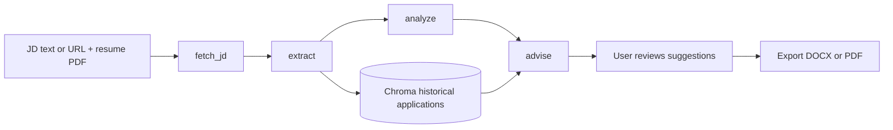

# JobFit Studio

> AI-powered job matching and resume tailoring for job seekers.

[](LICENSE)
[](https://www.python.org/downloads/)
[](https://github.com/langchain-ai/langgraph)
[](https://www.docker.com/)

[中文说明](README-CN.md)

JobFit Studio is a local-first job search assistant. It compares a job description (JD) with a user-provided PDF resume, then produces a structured view of role requirements, resume evidence, skill gaps, tailored rewrite suggestions, and interview preparation topics. Users can review and edit suggestions before exporting a new DOCX or PDF resume.

JobFit Studio is a derivative project developed by GitHub user **BigGooseDun** from the open-source [JD-Scout](https://github.com/AlanYy-42/JD-Scout) project. The original project and its author retain their original copyrights. This project preserves the upstream MIT license notice and adds user-reviewed resume tailoring, DOCX/PDF generation, resume photo extraction, and template improvements. Attribution for additions and modifications is documented in the project [LICENSE](LICENSE).

## Features

- **Four-stage analysis workflow** built with LangGraph: fetch the JD, extract requirements, analyze resume gaps, and generate advice.
- **Evidence-based match report** with an overall score, per-skill status, resume evidence, and critical gaps.
- **Resume and interview advice** tailored to the target role.
- **Historical application context** stored locally and retrieved for similar roles.
- **Live progress updates** streamed to the web UI over Server-Sent Events (SSE).
- **JD input by text or URL**. URL fetching tries HTTPX first and falls back to Playwright for JavaScript-rendered pages.
- **User-reviewed resume export**. Confirm or edit suggested rewrites, then download a new DOCX or PDF without overwriting the source PDF.
- **Conservative rewrite application**. The exporter tries exact, normalized, and high-confidence fuzzy matching. Suggestions that cannot be safely located are included in a pending-review section; low-match resumes with few applied changes also receive polishing alternatives.
- **Resume template and photo support**. The exporter reflows extracted content, attempts to preserve a portrait from the source PDF, creates editable DOCX files, and embeds a CJK font in generated PDFs.
- **Bilingual UI** with system-aware light and dark themes.
- **CLI and Docker Compose** options for analysis and local web deployment.

### Capabilities inherited from JD-Scout

- **Four-node LangGraph workflow**: fetch the JD, extract requirements, analyze resume gaps, and generate advice, with Pydantic-constrained structured results.
- **Historical-application RAG**: Chroma retrieves similar past applications to provide context for current advice.
- **Resume-grounded output**: prompts ask the model to base its analysis on resume evidence, while schema validation, empty-output checks, and retries handle some output failures; users should still review generated content.
- **SSE progress updates** for the `fetch → extract → analyze → advise` stages.
- **Hybrid scraping**: HTTPX first, with Playwright for JavaScript-rendered pages; it does not bypass login or anti-bot controls.
- **Bilingual interface and theme support**, retained from the upstream project.

## Feature Preview

### Original project demo

The following screenshot is an upstream JD-Scout demo case, included to show the job-matching interface inherited by this project. The screenshot and the original feature demonstration belong to the upstream project.


### New JobFit Studio feature

The following screenshot shows the interview question suggestions and resume download controls added in this project.


## Workflow



The four nodes share data through `AgentState`. DeepSeek generates JD requirements, resume gap analysis, and advice, with Pydantic schemas constraining the output structure. The advice node retrieves similar past applications; if retrieval fails, it continues without historical context. SSE streams workflow progress to the browser, SQLite stores analysis history, and Chroma manages vector search.

Resume export only applies user-confirmed rewrites. If the exporter cannot safely locate the original text, it keeps the suggestion in a pending-review section instead of forcing a replacement.

## Quick Start

### Local setup

#### Prerequisites

- Windows, macOS, or Linux with Python 3.11 or newer.
- [uv](https://docs.astral.sh/uv/) manages the virtual environment and installs the locked dependencies from `pyproject.toml` and `uv.lock`; you do not need to install Python packages individually.
- A DeepSeek API key is required for AI analysis. You can install the project without one, but analysis requests will not work.
- Network access is needed for the initial Python dependency installation and first download of the multilingual embedding model. URL fetching also requires access to the target site.
- Playwright Chromium is only needed to scrape JavaScript-rendered job pages. Skip browser installation if you always paste JD text.
- PDF export requires an available CJK TrueType font. Windows uses a system font when available; the Docker image includes Noto CJK. On other Linux hosts, install a CJK font such as Noto CJK or set `JDSCOUT_CJK_FONT`.

#### Installation

On Windows, install Python and then install uv with `winget install astral-sh.uv`. On macOS/Linux, follow the [official uv installation guide](https://docs.astral.sh/uv/getting-started/installation/).

```bash
git clone https://github.com/BigGooseDun/JobFit-Studio.git
cd JobFit-Studio
uv sync
```

`uv sync` creates the project virtual environment in `.venv` and installs runtime dependencies from the project metadata and lock file. Copy `.env.example` to `.env` and set `DEEPSEEK_API_KEY`. In Windows PowerShell, use:

```powershell
Copy-Item .env.example .env
```

Install the Playwright browser only if you need dynamic URL scraping:

```bash
uv run playwright install chromium
```

Start the web app:

```bash
uv run uvicorn jdscout.api.server:app --host 127.0.0.1 --port 8000
```

Open <http://127.0.0.1:8000>. `uv run` executes commands in the project environment. The first similar-history search downloads the `paraphrase-multilingual-MiniLM-L12-v2` Sentence-Transformers model; later runs load it from the local cache.

### Docker Compose

```bash
cp .env.example .env
# Set DEEPSEEK_API_KEY in .env
docker compose up --build
```

Open <http://localhost:8000>. Compose mounts `~/.jdscout` for persistent history and vector data.

### CLI analysis

```bash
uv run python -m jdscout.cli \
  --jd "Paste the full JD text or provide a job-posting URL" \
  --resume examples/sample_resume.pdf \
  --output result.json
```

DOCX/PDF resume export is available in the web workflow: review and confirm the suggestions after analysis, then choose Word or PDF download.

## Configuration

Set values in the project-root `.env` file:

| Variable | Required | Description |
| --- | --- | --- |
| `DEEPSEEK_API_KEY` | Yes | Model API credential from [DeepSeek Platform](https://platform.deepseek.com/). |
| `CHROMA_DIR` | No | Chroma vector-store path; defaults to `~/.jdscout/chroma`. |
| `SQLITE_PATH` | No | SQLite history database path; defaults to `~/.jdscout/history.db`. |
| `JDSCOUT_CJK_FONT` | No | Path to a CJK font for PDF export. The exporter searches system fonts when unset; the Docker image provides Noto CJK. |

Never commit a real API key. `.env` is excluded by `.gitignore`; review staged changes before publishing.

## Tech Stack

- **Language**: Python 3.11+
- **Workflow and model calls**: LangGraph, LangChain, DeepSeek OpenAI-compatible API
- **Structured data**: Pydantic
- **Backend**: FastAPI, Uvicorn, SSE
- **Frontend**: Vanilla HTML, CSS, and JavaScript
- **PDF processing**: pdfplumber, pypdfium2, Pillow
- **Resume generation**: python-docx, ReportLab
- **History and retrieval**: SQLite, Chroma, Sentence-Transformers (`paraphrase-multilingual-MiniLM-L12-v2`)
- **Web scraping**: HTTPX, BeautifulSoup, Playwright
- **Dependencies and deployment**: uv, Docker, Docker Compose

## Acknowledgments

This project continues development from [JD-Scout](https://github.com/AlanYy-42/JD-Scout). Thanks to its original author and the maintainers and contributors of LangGraph, LangChain, DeepSeek, Chroma, Sentence-Transformers, and Lucide.

## Limitations and Notes

- The project targets personal local use. It currently has no authentication, multi-user isolation, or SaaS-grade security; do not expose it directly to the public internet.
- Model output can be incomplete or incorrect. Schema validation and evidence-focused prompts reduce risk but do not replace human review.
- Job sites may require login, block scraping, or rely on dynamic rendering. Paste the JD text when URL fetching fails. Playwright does not bypass access controls.
- PDF extraction may be incomplete for scanned documents, complex multi-column layouts, or unusual font encodings. Photo extraction is best-effort.
- Generated DOCX/PDF files reflow extracted content and are not pixel-identical copies of the source resume. Review content, pagination, and layout before applying.
- RAG uses local application history as context. Similarity does not guarantee that a suggestion is correct or eliminate model errors.
- The Sentence-Transformers model may need to be downloaded on first use. Verify that it is cached before running offline.

## Development and Tests

```bash
uv sync --extra dev
uv run pytest
```

Dependencies are declared in `pyproject.toml` and fully resolved in `uv.lock`; this project does not use `requirements.txt` as its dependency source. After changing dependencies, run `uv lock` to refresh the lock file, then run `uv sync` to verify the environment.

## License

This project is licensed under the [MIT License](LICENSE).
